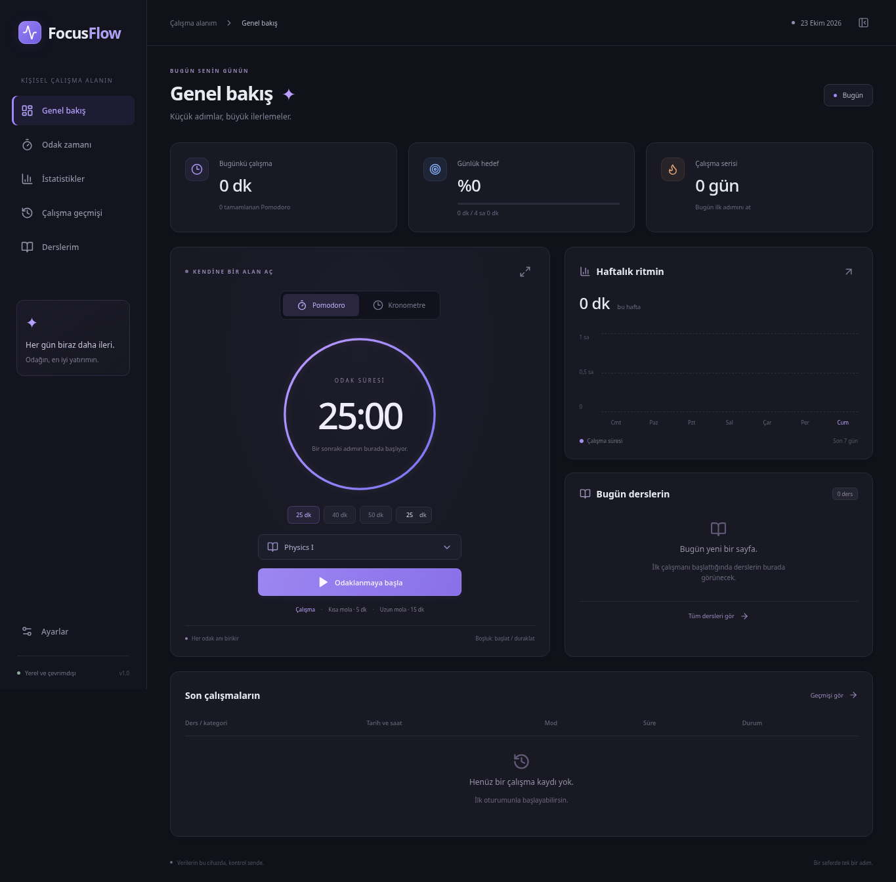
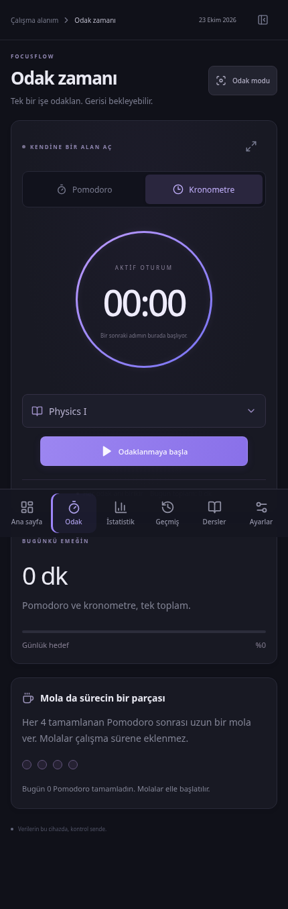

# FocusFlow

Dersini seç, Pomodoro veya kronometreyi başlat, gün sonunda hangi derse ne kadar zaman ayırdığını gör. FocusFlow, Android ve Linux için Türkçe ve İngilizce bir çalışma takip uygulamasıdır. Bütün oturumlar aynı SQLite geçmişine kaydedilir; duraklamalar ve molalar çalışma toplamına eklenmez.

Uygulama internetsiz çalışır. Hesap açman gerekmez; kayıtların kendi cihazında tutulur.

**[Android APK indir](https://github.com/izzettinmr/focusflow/releases/latest/download/FocusFlow.apk)** · [Sürümler](https://github.com/izzettinmr/focusflow/releases) · [Kılavuzlar](docs/README.md)

## Ekran görüntüleri

| Masaüstü · Genel bakış                                                                                                                       | Mobil · Kronometre                                                                                                                    |
| -------------------------------------------------------------------------------------------------------------------------------------------- | ------------------------------------------------------------------------------------------------------------------------------------- |
|  |  |

Görüntüler, geçici test veritabanıyla çalışan gerçek arayüzden alınmıştır. İlk kurulumun çalışma geçmişi boştur.

## Neler yapabilirsin?

- **Pomodoro:** Çalışma süresini belirle; başlat, duraklat, devam et veya erken bitir. Tamamlanan çalışma otomatik kaydedilir.
- **Kronometre:** Sıfırdan sayan oturumunu takip et. Aktif oturum süresini ve bugünkü toplamını ayrı gör.
- **Ortak geçmiş:** İki modun sürelerini tek yerde topla. Aynı anda bir çalışma oturumu bulunur; aynı süre iki kez sayılmaz.
- **Ders takibi:** Physics, Linear Algebra, Medical Biology gibi derslere zaman ayır; kendi kategorilerini ekle ve düzenle.
- **İstatistikler:** Günlük, haftalık ve aylık toplamlar; 7/30 günlük grafikler, ders dağılımı, hedef ve çalışma serisi.
- **Wi-Fi eşitleme:** Aynı yerel ağdaki telefon ve bilgisayar arasında dersleri ve bitmiş çalışmaları birleştir.
- **Kayıt yönetimi:** Geçmişi filtrele ve düzenle. JSON yedeği al, geri yükle veya CSV dışa aktar.
- **Dil seçimi:** Ayarlar → Dil / Language → English veya Türkçe; seçimini kaydet, yeniden açılışta korunsun.
- **Yerel kullanım:** Koyu tema, odak modu, bildirimler; Linux'ta sistem tepsisi, Android'de arka plan zamanlayıcı hizmeti.

## Kurulum

### Android

**[FocusFlow.apk dosyasını indir](https://github.com/izzettinmr/focusflow/releases/latest/download/FocusFlow.apk)** ve telefonunda aç. Android isterse indirmeyi açtığın tarayıcıya veya dosya yöneticisine **bu kaynaktan yükleme** izni ver. **Yükle → Aç** seç; ilk çalışma başlatıldığında bildirim iznini ver.

Android **8.0+**, **ARM64 veya x86_64** gerekir. APK yaklaşık **9 MB** boyutundadır. 32 bit ARM desteklenmez. Android System WebView güncel olmalıdır.

Üreticinin pil yönetimi zamanlayıcıyı durduruyorsa uygulamanın Android pil ayarından **Sınırsız** seç. Güncelleme için JSON yedeğini alıp yeni APK'yı uygulamayı kaldırmadan üzerine yükle.

[Android kurulum ve derleme ayrıntıları →](android/README.md)

### Linux · CachyOS / Arch

[Linux önkoşullarını](docs/linux.md#yeni-bir-cachyos--arch-kurulumu) kurduktan sonra:

```bash
git clone https://github.com/izzettinmr/focusflow.git
cd focusflow
npm ci
npm run tauri -- build --no-bundle
./scripts/install-local.sh
```

Uygulama menüsünden **FocusFlow**'u aç. Geliştirme sırasında `npm run desktop` kullanabilirsin. Yayımlanan hazır paket şu anda Android APK'sıdır; Linux sürümü kaynak kodundan derlenir.

[Linux kurulumu ve AppImage oluşturma →](docs/linux.md)

## Günlük kullanım

1. **Odak zamanı** ekranında dersini ve çalışma modunu seç.
2. Çalışmayı başlat; ara verdiğinde duraklat, döndüğünde devam et.
3. Oturumu bitir. Pomodoro süresi dolarsa kayıt otomatik tamamlanır; erken bitirirsen gerçek çalışma süresi saklanır.
4. **Genel bakış**, **İstatistikler** ve **Çalışma geçmişi** ekranlarından toplamlarını incele.

Örneğin 40 dakika Pomodoro + 35 dakika kronometre + 50 dakika Pomodoro, **2 saat 5 dakika** çalışma olarak görünür.

## Telefon ve bilgisayarı eşitle

İki cihazda da **1.1.0 veya üzeri** sürümü kullan. Bilgisayarda **Ayarlar → Wi-Fi eşitleme → Bu bilgisayarda eşitlemeyi aç** seç. Görünen bağlantı kodunu telefondaki aynı bölüme yapıştırıp **Eşleştir ve eşitle** düğmesine bas.

FocusFlow bilgisayarda açıkken aynı yerel ağdaki cihazlar yaklaşık 30 saniyede bir eşitlenir. Bitmiş çalışmalar, dersler, geçmiş düzenlemeleri ve silmeler birleştirilir. Aktif sayaç ve süre ayarları cihazında kalır. Çakışan çalışma aralıkları toplamı artırmadan reddedilir.

[Wi-Fi eşitleme ve bağlantı sorunları →](docs/wifi-sync.md)

JSON geri yükleme ayrı bir işlemdir: hedef geçmişi değiştirir. Kayıtları birleştirmek için Wi-Fi eşitlemesini kullan.

## Proje yapısı

```text
focusflow/
├── src/                  React + TypeScript arayüzü
├── src-tauri/            Ortak Rust/SQLite motoru ve Linux Tauri kabuğu
│   ├── src/              Zamanlayıcı, kayıtlar, dosya işlemleri, masaüstü
│   ├── tests/            Güvenlik ve veri bütünlüğü testleri
│   └── examples/         İzole arayüz ve denetim test taşıyıcıları
├── android/              Android uygulaması ve platform kılavuzu
│   ├── java/             WebView, hizmet, bildirim ve alarm
│   ├── rust/             Ortak motora JNI köprüsü
│   └── res/              Yerel Android kaynakları
├── scripts/              Kurulum, derleme ve test araçları
├── docs/                 Kullanım, geliştirme ve mimari belgeleri
│   ├── screenshots/      README ekran görüntüleri
│   └── validation/       Masaüstü doğrulama raporu
└── audit/                Tarihli güvenlik ve bellek incelemesi
```

Arayüz React + TypeScript, kayıt motoru Rust + SQLite'tır. Linux'ta Tauri 2, Android'de Java/WebView + JNI kullanılır. Süre ve kayıt hesaplarını ortak Rust motoru yürütür.

## Belgeler

[Telefon ve bilgisayar arasında Wi-Fi eşitleme](docs/wifi-sync.md)

| Konu                                               | Kılavuz                                     |
| -------------------------------------------------- | ------------------------------------------- |
| Kontroller, kısayollar ve yedekleme                | [Kullanım](docs/usage.md)                   |
| Linux önkoşulları, geliştirme ve kurulum           | [Linux](docs/linux.md)                      |
| APK kurulumu, Android derleme ve telefon davranışı | [Android](android/README.md)                |
| Ortak kayıt motoru ve süre güvenilirliği           | [Mimari](docs/architecture.md)              |
| Test komutları ve tamamlanan doğrulamalar          | [Testler](docs/testing.md)                  |
| Güvenlik bulguları, düzeltmeler ve kalan uyarılar  | [Denetim raporu](audit/2026-10-22/RAPOR.md) |
